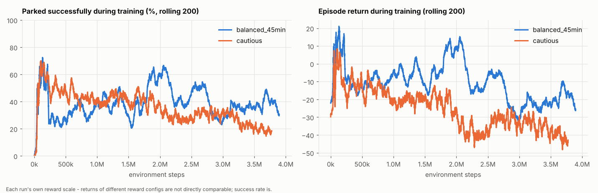
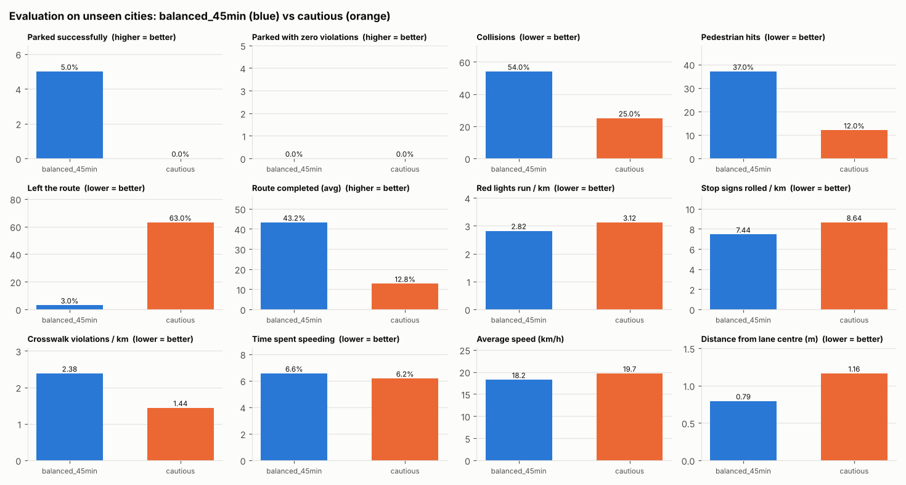

# balanced_45min vs cautious

## Summary

- **balanced_45min** is better at *parked successfully* (5.0% vs 0.0%).
- **cautious** is better at *collisions* (54.0% vs 25.0%).
- **cautious** is better at *pedestrian hits* (37.0% vs 12.0%).
- **balanced_45min** is better at *left the route* (3.0% vs 63.0%).
- **balanced_45min** is better at *route completed (avg)* (43.2% vs 12.8%).
- **balanced_45min** is better at *red lights run / km* (2.82 vs 3.12).
- **balanced_45min** is better at *stop signs rolled / km* (7.44 vs 8.64).
- **cautious** is better at *crosswalk violations / km* (2.38 vs 1.44).
- **balanced_45min** is better at *distance from lane centre (m)* (0.79 vs 1.16).
- Careful: **cautious** completes much less of its routes (13% vs 43%), so its episodes end early. Lower crash or violation *rates* can simply mean it drove less, not that it drove better.
- Note: the success-rate confidence intervals overlap (2-11% vs 0-4%), so that difference may be luck. Evaluate on more cities (--n) to be sure.

## Reward settings

| Term | balanced_45min | cautious |
|---|---|---|
| progress | 0.1 | 0.1 |
| goal_reached | 30 | 30 |
| parking_precision | 15 | 15 |
| **collision** | 50 | 100 |
| **pedestrian_hit** | 100 | 300 |
| **pedestrian_proximity** | 0.1 | 0.4 |
| **crosswalk_yield** | 10 | 30 |
| **speeding** | 0.05 | 0.2 |
| **red_light** | 20 | 50 |
| **stop_sign** | 10 | 30 |
| **lane_deviation** | 0.03 | 0.06 |
| **off_road** | 0.2 | 0.5 |
| **comfort** | 0.01 | 0.03 |
| **stall** | 0.03 | 0.02 |
| **time** | 0.005 | off |
| off_route | 20 | 20 |
| stuck | 20 | 20 |
| speed_bonus | off | off |

| Setting | balanced_45min | cautious |
|---|---|---|
| speed_tolerance_kmh | 3.0 | 0.0 |
| ped_proximity_radius_m | 4.0 | 6.0 |

Rows in **bold** differ.

## Training

| | balanced_45min | cautious |
|---|---|---|
| Steps trained | 3,897,088 | 3,776,336 |
| Final curriculum stage | S2 traffic rules | P4 park from 25-70 m |
| Wall-clock minutes | 45.0 | 45.0 |

## Evaluation (100 / 100 unseen cities, S6 full city)

| Metric | balanced_45min | cautious |
|---|---|---|
| Parked successfully | 5.0% ✔ | 0.0% |
| Parked with zero violations | 0.0% | 0.0% |
| Collisions | 54.0% | 25.0% ✔ |
| Pedestrian hits | 37.0% | 12.0% ✔ |
| Left the route | 3.0% ✔ | 63.0% |
| Route completed (avg) | 43.2% ✔ | 12.8% |
| Red lights run / km | 2.82 ✔ | 3.12 |
| Stop signs rolled / km | 7.44 ✔ | 8.64 |
| Crosswalk violations / km | 2.38 | 1.44 ✔ |
| Time spent speeding | 6.6% | 6.2% ✔ |
| Average speed (km/h) | 18.2 | 19.7 |
| Distance from lane centre (m) | 0.79 ✔ | 1.16 |
| Parking error (0 = perfect) | 0.47 | - |
| Time to park (s) | 67.2 | - |

✔ = better of the two.

## Side-by-side drive

`side_by_side.mp4`: both cars in the same unseen city (seed 50000007). Left = **balanced_45min** (collision), right = **cautious** (off_route). Stereo: left ear = balanced_45min, right ear = cautious.

